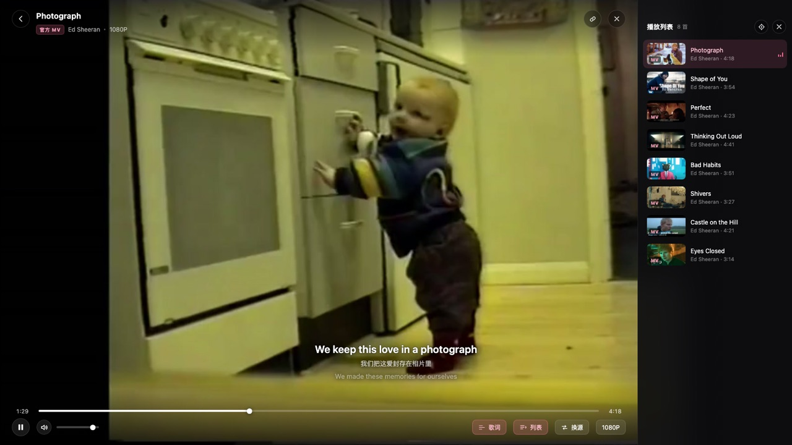

# MV 影院 · MV Cinema

Folia（Folium 1）模组：播放栏进度条右侧多一个 **MV** 按钮，点一下就地**全屏看这首歌的 MV**——像 QQ 音乐那样，带原声、有进度条、有自己的音量。

和已收录的 `bili-mv-window` 区别：那个是**常驻小窗**（静音画面、可拖动），这个是**全屏影院**（点开才出现、带 B 站原声、退出即卸流），按用法挑就行。



> 作者：`mod.json` 里的 `pomepii` 与提交 / 维护账号 `Zhangyx0824` 是同一个人（前者是模组内署名，后者是 GitHub 账号）。

## 为什么不是「角落里的小窗」

已有的 `bili-mv-window` 把 B 站视频塞进播放页右下角，一直挂着。它解决的是「有比没有好」，但对一个音乐播放器来说，**常驻的画中画本身就是干扰**：影响看歌词、看封面，而且只取视频轨，画面里没有声音。

这个模组换了个方向：

- **不常驻**：只有一个 26px 的按钮，位于进度条右侧（和「歌曲资料」「评论」同一排）。
- **按需打开**：点了才去搜、才建播放器，退出立刻卸掉视频源，不留后台流量。
- **全屏 + 有声**：MV 占满整个窗口，播放 B 站的原声，而不是静音的画面。
- **画面干净**：顶部标题栏和底部控制条 3 秒不动鼠标就淡出，只剩电影画面。

## 功能

- **进度条 MV 按钮**：跟随主题文字颜色，小窗（宽 < 600 或高 < 220）自动隐藏；没有正在播放的歌时置灰。
- **全屏播放页**：视频 `object-fit: contain` 居中铺满，黑场淡入；顶部是「歌名 / 官方 MV / 歌手 / 画质」和返回、复制 B 站链接、关闭三个按钮。
- **自带控制条**：进度条（可拖动、指针捕获，拖出控件也不会断）、播放暂停、当前时间/总时长、音量（用 `folium.storage` 记住上次值）、播放列表、换源、画质切换。停手 2.8 秒自动收起（暂停时也收，想干净地看一帧画面时不会再被进度条挡住），动一下鼠标或点一下画面就回来。
- **点画面＝播放/暂停**：跟 QQ 音乐、YouTube 一样，画面本身就是最大的那个播放键；点控件、卡片、播放列表上的位置不算。左下角那个按钮和点画面走同一条路，一次点击只切一次。
- **歌词（可选，默认关）**：如果这一支 MV 跟这首歌**一样长**（±5 秒或 2%，说明用的是同一段录音），控制条右侧会多一个「歌词」开关。点开把宿主这份歌词铺在画面下方 —— 当前句加粗、翻译在下面、下一句淡淡地垫着，跟着 MV 自己的进度滚（看 MV 时宿主的音乐是停的，时钟只能用视频的）。再点一下关掉。长度对不上、宿主没有这份歌词、或者宿主的歌已经换成另一首时不出现这个开关，免得整篇词跑偏。中文英文都行，主要给那些没有字幕的英文 MV 用。
- **不碰宿主私有通道、也不猜宿主 DOM**：整窗全屏请用 Folia 右上角自带的全屏按钮。模组不调用宿主 preload 的私有接口，**也不扫宿主的按钮 / 类名、不往宿主的列表里插东西**——抽屉标题栏让位用的是固定高度（40px = 宿主顶栏 32px + 8px 间距），不随窗口量来量去；控件在停手 2.8 秒后照常自动收起，只剩画面。等宿主在 `folium.ui` 下开放公开的整窗全屏接口后再接回来。
- **播放列表**：右侧抽屉列出 Folia 播放队列里的歌（整条都在，当前这首高亮并带跳动的音量条），每行一张 B 站 MV 封面 + 歌名/歌手/时长；点哪一行就**就地放那一行的 MV**。封面按需加载：滚动到可视区附近（下方预留一屏）才去搜那一首的封面，一次只发 3 首，回来一批贴一批；还没轮到的行显示一个胶片格占位图标（描边用内阴影画，圆角不会被切掉），图到了再淡入。图床那张换成了 `@176w_100h_1c.webp` 的小图，搜到的封面会落盘缓存。列表标题只报这张列表里实际有多少首（宿主队列是几百首的大歌单、这里最多列 60 首，就不再写「48/439」那种看着像丢歌的数字，完整条数放在 hover 提示里）；从搜索列表点进来的那首如果不在宿主队列里，会单独置顶成当前项 —— 不会拿宿主队列的下标去高亮另一首歌。标题栏的准星按钮**一键定位到正在看的那首**（滚到中间再闪一下），面板一拉开也自动落在那一行。抽屉的黑色底色通顶，但标题栏的内容（「播放列表」/ 准星 / 叉号）会下移一个固定高度，避开宿主浮在右上角的窗口按钮（上一首 / 播放 / 下一首 / 远程 / 全屏），不再被压住；换源抽屉同此。
- **换源**：列表旁边那个「换源」按钮拉开另一个抽屉，列出**同一首歌的其他 MV 投稿**（封面 / UP 主 / 时长 / 匹配分，正在看的那支打「正在看」），点一支就按它的 bvid 直接换过去；也能自己改关键词重搜（例如「歌名 歌手 MV」「歌名 现场」）。挑中的会按这首歌记住，下次打开优先用它。换源同样不动宿主，所以不会把你顶到歌曲播放页。
- **连播**：一支 MV 放完自动播队列里的下一首（可在设置里关）。
- **点列表不动宿主**：宿主那套 `playQueueItem` / `playSong` 会顺手打开 Folia 自己的播放页，把 MV 页顶掉（表现就是「点了列表里的 A，却跳去歌曲播放界面」）。所以看片期间一律不动宿主，只记下点的是哪一行；**退出影院时**才把宿主队列挪到那一首，音乐从那首接着放。
- **键盘**：`空格` 播放暂停、`←/→` 前后 5 秒、`L` 开合播放列表、`S` 开合换源、`Esc` 退出（抽屉开着时先收抽屉）。
- **有声音**：DASH 音视频是两条独立文件，这里用 `<video>` + `<audio>` 双元素，每 800ms 校一次漂移（> 0.3 秒才纠正）；拿不到音频轨时退回 `durl` 那条含着音轨的整段 mp4（最高 720P，音画天生同步）。
- **暂停音乐**：打开时暂停 Folia 里的音乐（可在设置里关），退出时接着放；如果看 MV 期间你按了媒体键把音乐又开起来，模组会把它压回去，避免两路声音打架。
- **搜错了能救**：全屏页里给一个输入框改关键词重搜，也列出按匹配度排序的候选（封面/标题/UP 主/时长/匹配分）。手动挑的那一个会记住（存 `folium.storage`），下次这首歌直接用。
- **换歌跟着换片**：媒体键切歌、宿主自己换歌时 MV 跟着切到新歌（不再停在上一首）；点播放列表则走上面那条「就地放、不动宿主」的路。
- **状态说人话**：搜不到、没登录、被风控、网络断、没有可用源——每种都是不同的文案和不同的下一步按钮。
- **扫码登录**：命令面板「B站账号：扫码登录」直接画二维码，扫完把 Cookie 写进系统凭证库；另有「检查登录状态」。

## 设置

| 项 | 默认 | 说明 |
|---|---|---|
| 画质上限 | 自动 | 自动＝登录了要 1080P、没登录要 720P；也可写死 1080P60 / 1080P / 720P / 480P。大会员才有 1080P60 与 4K。 |
| 看 MV 时暂停音乐 | 开 | 关掉两路声音会一起响。 |
| 一段放完接着看下一首 | 开 | 按播放队列顺序连播；关掉就停在最后一帧。 |
| MV 音量 | 90% | 与 Folia 的音乐音量分开。 |
| B 站 Cookie | 空 | 不填也能看（最高 720P）；填了/扫码后才有 1080P 以上。 |

## 权限

```json
"permissions": ["stageLayers", "playback.control", "filesystem.data"]
```

- `stageLayers`：全屏层挂在宿主公开的 `app.overlay` 槽位上（`interactive: false`，关闭时整棵树 `display: none`，不会挡住任何点击）。
- `playback.control`：只调 `playback.pause` / `playback.play`，用来在看 MV 时把音乐让开；另外在退出影院时用一次 `playback.playQueueItem` 把宿主队列补到刚看的那首。
- `filesystem.data`：记「这首歌用哪个视频」和音量，走 `folium.storage` / `folium.secrets`。
- **只读 B 站**：不看弹幕、不发弹幕、不投币、不点赞、不关注、不下载，写操作一个都没有。

## 它是怎么取流的

1. `wbi` 签名搜视频（`/x/web-interface/wbi/search/type`），顺带 `-412` 风控时换会话重试一次。
2. 打分排序：歌名命中权重最高；**歌手名主要看 UP 主名字**（官方号/本人号是强信号），标题里的歌手名算次级；再按时长差、播放量、点赞数、`MV/官方/中字` 之类强信号加减，明显是音频向（`Hi-Res/无损/歌词/鼓谱/8D`）的投稿扣分——全屏看一张静态封面很难接受。
3. **三档「官方」信号**层层加码：
   - 投稿分区 `typename === 'MV'`（193）直接 +30：这是投稿人自己选的分类，比标题里写 MV 可信得多；
   - UP 主名字命中「官方 / 工作室 / 唱片 / OFFICIAL」或已知厂牌（环球、索尼、华纳、滚石、杰威尔…）；
   - **UP 主认证**（`/x/web-interface/card`，只查排名前 4 个、按 mid 缓存 6 小时）：机构认证 +22，认证名里带歌手名 +12，歌手本人的个人认证号 +16。查不到就当没有，绝不阻断。
4. 头一批结果不够像 MV 时（分区不是 MV 或分数偏低），**再补搜一次「歌名 歌手 MV」**并合并去重——实测这两次搜索的结果重合度很低，B 站上「歌名 歌手」的头部经常是 Hi-Res 音频投稿。搜索结果按关键词缓存 8 分钟，既省时间也避开短时间重复搜索被回空列表。
5. `view` 取 `cid`，然后**同时**问 `playurl` 的 DASH（`fnval=4048`）和 `durl`（`fnval=1`），拿实际能到的那一档里**更高、且有声音**的那个。
   - 分P投稿不信 `data.cid`（它只指向 P1）：音乐区很多投稿 P1 是十几秒预告、P2 才是完整 MV，所以有 `pages` 时取**时长最长**的那一 P。
   - 整支都不到 20 秒的（预告 / 切片 / 试听）不算 MV：排序时整批沉底、取流时直接跳过；第一名取不到流就顺着候选往下试（最多 4 个），不会因为第一名是片段就整次失败。
6. 本地 `127.0.0.1` 只读代理补上 `Referer` / `UA` 并透传 `Range`——B 站 CDN 的防盗链和 `http` PCDN 节点都靠它；`token` 只存在主进程，端口扫到了也只会 404。

## 开发

```bash
node test/unit.mjs           # index.cjs 的纯函数：分P取正片 / 十几秒片段沉底 / 封面缩略图
node test/smoke.mjs          # jsdom 冒烟测试：按钮 → 搜索 → 全屏 → 播放列表点播 / 定位 / 换源 → Esc 退出、失败态、老宿主降级
node test/build_preview.mjs  # 用真 B 站 MV 的一帧重画预览图（需要本机 ffmpeg + Chrome）
# 同步到本机 Folia：先彻底退出 App，再同步，最后重新启动
# （不要用 ./sync.sh --restart：App 没完全退出时它会用旧摘要覆盖授权，改动不生效）
osascript -e 'tell application "Folia" to quit'
./sync.sh
open -a Folia
```

结构：`client.mjs`（渲染进程，UI 与播放器）、`index.cjs`（主进程，B 站接口 + 本地代理 + 扫码登录）、`vendor/qrcode.mjs`（MIT）。

## 已知边界

- MV 的画面和声音来自两个文件时，极端情况（长时间缓冲、系统休眠唤醒）可能会有一次可听见的对齐；对齐阈值是 0.3 秒，避免频繁微调。
- B 站没有这首歌、或者只有音频投稿时，全屏看并不好看——候选列表里挑一个现场版通常比自动选中的更好。
- 播放列表的封面是「搜一下」拿到的，不是逐个取流，所以偶尔会有某首搜不到 MV（显示成胶片格占位图标），点开时仍会自动搜一次；没滚到的行不会提前去搜。
- 歌词只能在「这一支 MV 跟这首歌一样长」时借用宿主那份时间轴（±5 秒或 2%）：MV 若是重新剪辑、带对白前奏、或现场版，长度对不上就不给开关——宁可没有，也不要整篇跑偏。歌词数据和时长 / 封面一样从 `folium.internals.stores.playback` 读，`internals` 在 Folium 2 里会去掉，那时这个开关会自动不出现。
- 按 Folia 0.8.0（模组 API 1.10）适配：0.8.0 起宿主给模组的 song DTO 只剩 `{id,title,artist,album,source,ref}`，时长与封面都不在里面。为了让挑片时的时长比对继续有效、列表也能先摆上专辑图，这里会从 `folium.internals.stores.playback` 把时长 / 封面 / 多歌手补回来；那个入口拿不到时，退回「只有歌名和歌手」，功能不受影响。`internals` 只在 manifest 声明 `folium: 1` 时可用，**Folium 2 会去掉它**，迁移到 `folium: 2` 时这段要改用公开接口（或退化成没有时长 / 封面）。
- 模组不往宿主的歌曲列表里插按钮，也不靠宿主的类名定位任何元素：入口只有进度条右侧的 MV 按钮和命令面板。这样宿主改界面不会让模组失效，代价是没有「行级 MV 图标」——那需要宿主开放行级插槽或 `folium.ui` 接口。
- 点列表里的歌不会立刻改宿主的播放队列：退出影院时才补过去。所以看片期间在 Folia 其它界面看到的「正在播放」还是原来那首。
- 队列长度由宿主 `getQueue` 决定（默认取 100 条、界面最多列 60 行）。
- 未登录时 `durl` 多数只到 720P（个别能到 1080P）、DASH 常常只给 480P，这是 B 站的限制，不是模组的。

## 许可

MIT。视频内容版权归哔哩哔哩及原 UP 主，本模组只做播放器，不存储、不转载。
